I build the whole measurement chain: the optics and electronics that sense, the firmware that acquires the signal, and the math and models that turn it into an answer. I'm currently working on **[AirGradient](https://www.airgradient.com/)** air-quality monitor firmware. Before that I worked on atmospheric LiDAR, telescope prototypes and FPGA links to RF hardware, and I research domain adaptation for open-vocabulary segmentation.

**Portfolio:** [cheer.cerosoft.net](https://cheer.cerosoft.net) · **Based in** Chiang Mai, Thailand

### Selected work

| | Project | |
|---|---|---|
| **Optics & instruments** | [Atmospheric-LiDAR](https://github.com/Cheer3142/Atmospheric-LiDAR) | Acquisition and analysis for a Mie LiDAR: aerosol profiles from oscilloscope, transient-recorder and MPL data |
| | [NanoPZ-Focal-Plane-Mask-Ctrl](https://github.com/Cheer3142/NanoPZ-Focal-Plane-Mask-Ctrl) | Closed-loop focal-plane mask alignment: a Newport nano-piezo actuator driven by FWHM measured on a GigE camera |
| | [Fourier-Propagation-Simulation](https://github.com/Cheer3142/Fourier-Propagation-Simulation) | Fourier-optics simulation of telescope pupils, apodization and focal-plane intensity |
| **Hardware & firmware** | [FPGA-SPI-admv1013](https://github.com/Cheer3142/FPGA-SPI-admv1013) | VHDL SPI master controlling ADMV1013/1014 microwave up/down converters |
| | [firmware-one-openair](https://github.com/Cheer3142/firmware-one-openair) | Work on AirGradient ONE / Open Air air-quality monitor firmware |
| **Machine Learning** | [Gradient-FREE-Domain-Adaptation](https://github.com/Cheer3142/Gradient-FREE-Domain-Adaptation) | Training-free domain adaptation for open-vocabulary segmentation via LoRA adapter retrieval and fusion |
| **Software** | [CondoMateV2](https://github.com/Cheer3142/CondoMateV2) | Condo management PWA: parcel scanning, residents, online backup and failover |

### Toolbox

### Activity

  
  

